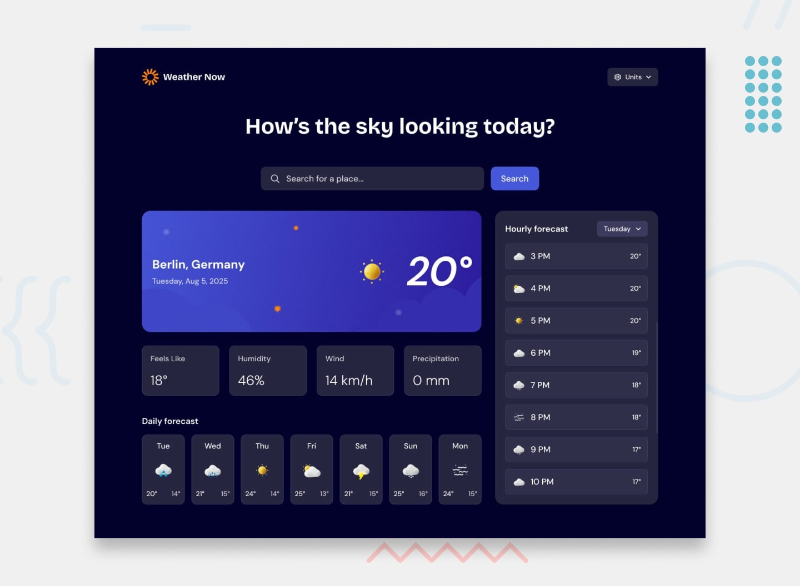
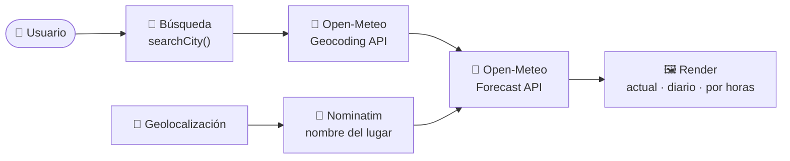

<div align="center">

# 🌤️ WeatherApp

**Consulta el tiempo de cualquier ciudad: condiciones actuales, previsión de 7 días y previsión por horas.**




</div>

---

## ✨ ¿Qué es?

Una aplicación del tiempo hecha con **HTML, CSS y JavaScript puro** (sin frameworks ni dependencias). Es mi solución al reto *Weather App* de [Frontend Mentor](https://www.frontendmentor.io/), y usa la API gratuita de [Open-Meteo](https://open-meteo.com/), que no necesita clave.

## 🎯 Funcionalidades

- 🔎 **Búsqueda de ciudades** con sugerencias mientras escribes.
- 📍 **Geolocalización**: puede mostrar el tiempo de tu ubicación actual.
- 🌡️ **Condiciones actuales**: temperatura, sensación térmica, humedad, viento y precipitación.
- 📅 **Previsión de 7 días** con máxima, mínima e icono de cada día.
- 🕒 **Previsión por horas**, con un selector para cambiar de día.
- 🔁 **Unidades métricas o imperiales** (°C/°F, km/h/mph, mm/in) desde un menú.
- 🌍 **Español e inglés**, con detección del idioma del navegador.
- 💾 **Recuerda tus preferencias** (idioma y unidades) con `localStorage`.
- 📱 **Diseño responsive** para móvil y escritorio, con estados de carga, error y "sin resultados".

## 🧭 Cómo funciona



1. Al buscar una ciudad, `searchCity()` consulta la **API de geocodificación** de Open-Meteo y muestra hasta 5 sugerencias.
2. Al elegir una, `loadWeather()` pide la **previsión** (temperatura, sensación térmica, humedad, viento, precipitación y código del tiempo, para hoy, 7 días y cada hora).
3. Las funciones `renderWeather()`, `renderDaily()` y `renderHourly()` pintan los datos. El código meteorológico se traduce a un icono con `getIcon()`.
4. Con la geolocalización del navegador, el nombre del lugar se obtiene con **Nominatim** (OpenStreetMap).

## 🗂️ Estructura

```
WeatherApp/
├── index.html          # Estructura de la página
├── app.js              # Lógica: búsqueda, API, render, idioma y unidades
├── css/                # Estilos divididos por sección (header, búsqueda, tarjeta principal, métricas, días, horas)
├── assets/             # Fuentes e iconos del tiempo
├── design/             # Diseños de referencia del reto (móvil, escritorio y estados)
├── style-guide.md      # Colores y tipografías del diseño
└── preview.jpg         # Captura del resultado
```

## 🚀 Cómo ejecutarla

No necesita instalación ni compilación. Elige una opción:

```bash
# Opción 1: abrir index.html directamente en el navegador

# Opción 2: servidor local (recomendado)
npx serve .
# o
python -m http.server 8000
```

Después abre la dirección que te indique el servidor, por ejemplo `http://localhost:8000`.

> 💡 La geolocalización del navegador solo funciona en `localhost` o con HTTPS.

## 🛠️ Tecnologías y servicios

| Qué | Para qué |
|---|---|
| HTML5, CSS3 | Estructura y diseño responsive |
| JavaScript (ES6+) | Lógica, `fetch`, `async/await` y `localStorage` |
| [Open-Meteo](https://open-meteo.com/) | Geocodificación y previsión del tiempo (gratuita, sin clave) |
| [Nominatim](https://nominatim.org/) | Nombre del lugar a partir de las coordenadas |

## 🎓 Sobre el reto

Este proyecto parte de un desafío de [Frontend Mentor](https://www.frontendmentor.io/): construir una aplicación del tiempo que se parezca lo máximo posible al diseño proporcionado (carpeta `design/`). Los diseños y los recursos gráficos pertenecen a Frontend Mentor.

---

<div align="center">Hecho con ☀️ por <a href="https://github.com/rodrrigg0">Rodrigo Bachiller Sanz</a></div>
